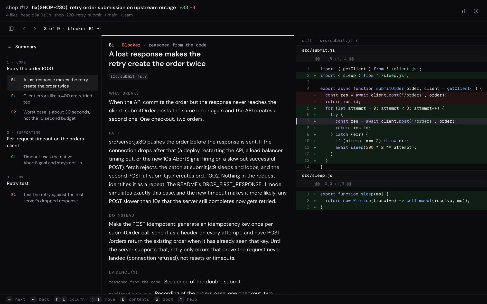
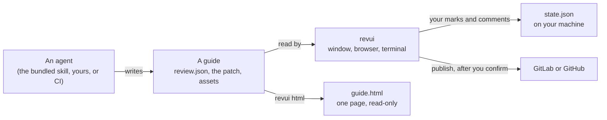

<p align="center">
  <picture>
    <source media="(prefers-color-scheme: dark)" srcset="docs/logo-dark.svg">
    
  </picture>
</p>

<p align="center">
  An agent reviews the merge request and writes a guide: the change in parts, each finding with how it was checked.<br>
  Read it in a window, in a browser, as one page from your pipeline, or in your terminal. You publish your own review.
</p>

https://github.com/user-attachments/assets/41ec459f-0c9d-4657-9fcf-ac237a80ae73

## Quick start

```sh
curl -fsSL https://raw.githubusercontent.com/Volpestyle/revui/main/install.sh | sh
revui <link>
```

That installs the latest released binary for macOS or Linux into `~/.local/bin`.
With Rust, `cargo install --git https://github.com/Volpestyle/revui` builds it instead.

You need the CLI of your code host, signed in (`glab` for GitLab or `gh` for
GitHub), and a coding agent: Claude Code works with no setup.

Paste the link of a merge request or pull request and an agent starts reviewing it.
The summary lands first, and you read it while the findings arrive one by one.
`revui <link>` reads it in your terminal. The [window](#in-a-window) and the
[one page](#as-one-page) read the same review.

## The guide

Every review is a guide: a plain folder an agent writes once, and every way of
reading it shows the same thing.

- **One card at a time, not a wall of diff.** The summary, then each part of the
  change, the core first, with the findings for its code beside the lines they cite.
- **Findings with evidence you can judge.** Each one says how it was checked:
  observed in a run, verified by a tool, or reasoned from reading. Screenshots,
  recordings and diagrams sit beside the code.
- **A map of where the change sits.** The components it touches and their
  neighbours, with what it adds, alters and removes marked. It is cut from a system
  map of the repo that the agent draws once and keeps for every later review
  (`revui map <dir>` prints it).
- **It follows the merge request.** A new push does not start you over. The agent
  reviews what changed since the head you read, keeps every finding's id and marks
  the ones that got fixed. Your verdicts come along, and what you already posted is
  not posted twice.

Two things it will not do:

- **Hide code.** A hunk the guide left out is flagged as "no section", and a
  guide that cites code outside the diff does not load.
- **Post for you.** Only what you agreed with, pushed back on or wrote yourself
  goes out, and only when you publish.

## In a window

The demo at the top is the window: the contents, the card, the diff and the review's
agent in columns, drawn on the GPU by one Rust interface. `h` and `l` move between
the columns, the arrow keys turn the cards, and everything is also a click. The Mac
app shows the list of your reviews and carries the `revui` it needs. `revui web <link>`
serves the same interface to your browser, compiled to WebAssembly.

Both are built from a checkout of this repo for now: neither is in the releases yet.

    cd gpu && ./bundle.sh                    # the Mac app: gpu/target/revui.app and a disk image
    cd gpu && trunk build --release          # once, for revui web (cargo install trunk)
    cargo install --path . && revui web <link>

[gpu/README.md](gpu/README.md) has the details.

## As one page

`revui html <dir>` writes the review as a single file, `guide.html`, that any browser opens with no revui and no server: the same cards, contents, diff and keys, read-only. A pipeline can keep it as an artifact of the merge request, or you can send it to someone.

    revui html <dir>              # writes <dir>/guide.html
    revui html <dir> review.html  # or where you say

Pictures are inside the file and diagrams are drawn from their source in the reader's light or dark theme. A recording plays from its file beside the page.



## In your terminal

https://github.com/user-attachments/assets/d3760f03-63f3-49e9-87cb-4804cf29262b

`revui` with no link lists your reviews, and the whole review happens there: the
agent and your editor open in tabs inside revui, pictures draw inline, and every
hint on screen is also clickable. It runs in any terminal, and inside Cursor, Orca,
Herdr, tmux or Ghostty it can use their panes, chat and browser instead of its own
tabs. [docs/terminal.md](docs/terminal.md) has the keys, the tour and those setups.

All three read and write the same guide, so a review started in one carries on in
another.

## From your pipeline

A project can write the guide in CI, so it is there when anyone opens the merge request: in revui, or as that one page, linked from the merge request itself.

    revui ci gitlab     # a job for .gitlab-ci.yml
    revui ci github     # a workflow for .github/workflows/

The reviewer it runs can only read: no shell, nothing it can write, no token for your host. Give the job a way to start your stack and it tests the change there too, and the guide carries a card for that run: each step and check, opening to its output. [docs/ci.md](docs/ci.md) has the setup.

Two more ways to have a guide waiting, both in [docs/config.md](docs/config.md):
`revui queue` lists the merge requests waiting for your review, and `revui prepare`
writes their guides with no one watching, from a scheduler.

## With an agent

Each review has one agent. It writes the guide, and it is the one you ask
afterwards, so it already knows the change. In the window it is a panel beside the
review; in the terminal it is a tab, or a pane of your terminal app.

- **Ask** about what you are looking at. The agent is told which finding you are on.
- **Verify** has it reproduce a finding, off your screen. The first time that needs
  the product running, it asks where: a local stack or a preview deploy for the
  change, staging or production (read only) for how things are today. It remembers
  the answer for that repo.
- **Diagram** has it draw one that explains a finding, without running anything.

Here it starts the demo project's own server, drops the first response, and confirms
that one checkout creates two orders (a real run, sped up where the badge says so):

https://github.com/user-attachments/assets/9749bb18-5c02-401a-beaa-2140f330ef93

## Your review

Agree with a finding or dismiss it, and comment on a finding, a line or a block of
lines. Publishing shows the exact text first, then posts it as one comment, one
comment plus approval, or a thread per point on the diff. Nothing goes out until you
confirm.

## Works with

| | |
| --- | --- |
| **Code hosts** | GitLab through `glab`, GitHub through `gh` |
| **Coding agents** | Claude Code out of the box, or any agent you can start from a command |
| **Editors** | Neovim, VS Code, or anything else that opens a file from a command |
| **Where you read it** | The Mac app, a browser, one HTML page, or any terminal |
| **Terminals** | Any. Images show inline with Kitty, Sixel or iTerm2 graphics, and as block characters elsewhere |
| **Where agents open** | A tab inside revui, with nothing to set up. Or a pane of yours: tmux, Herdr, Orca, zellij, anything that opens a pane from a command |

Agents, editors and panes are not built-in integrations: each is one command in the config. `revui setup` has your agent look at your machine, ask where things should open, and write those commands for you.

## Configuration

There is nothing you have to configure. `~/.config/revui/config.json` is for
changing a default: `revui doctor` checks it, and `revui setup` has an agent write
it for you.

Your editor, your agent and where each opens are one command apiece. See
[docs/config.md](docs/config.md) for every key.

## How it fits together



A guide is a plain directory. revui only reads it, so anything can write one:
`revui format` prints the format and `revui check <dir>` validates the result.

    revui                 paste a link, or pick up an earlier review
    revui <url>           start, or pick up, the review of that merge request
    revui <dir>           open a guide directly
    revui web <url>       the same review in a browser
    revui html <dir>      write it as one page
    revui ci gitlab       print a pipeline job that writes the guide
    revui prepare         write the guides you are waiting on, with no one watching
    revui help            every command

<sub>The wordmark is set in <a href="https://vercel.com/font">Geist Mono</a> (OFL-1.1).</sub>
